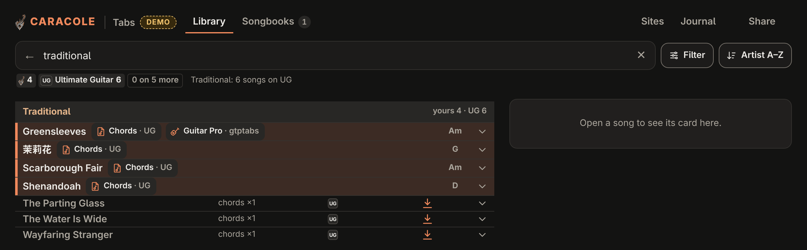
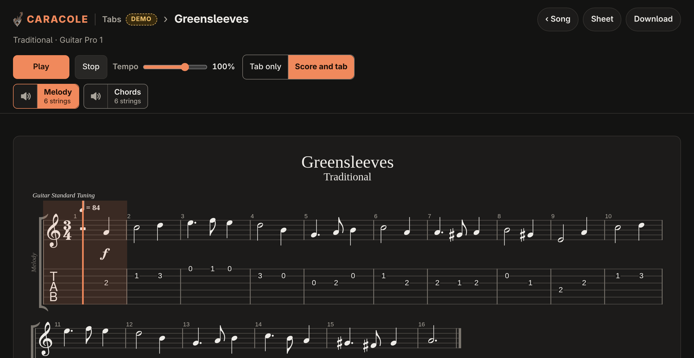
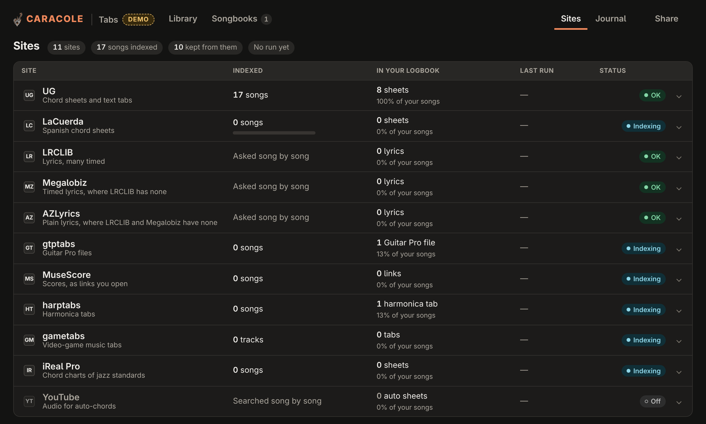
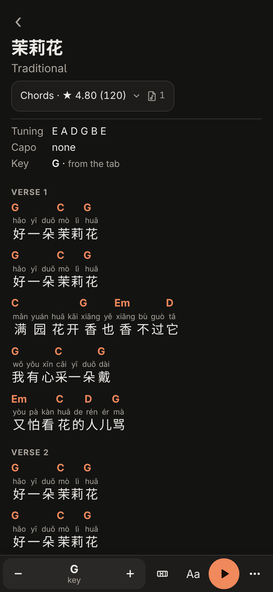

# caracole

**Your own songbook, built while you sleep.**

List the songs you want to play. Each night caracole finds their chords, lyrics and tabs and
saves them in a folder on your computer. Read them in the browser, on your phone, or on paper.



## What it does

- Finds chord sheets, lyrics, Guitar Pro files, harmonica tabs and jazz charts on [several sites](docs/sources.md).
- [Shows each sheet](docs/sheets.md) with transpose, capo, chord shapes for several instruments, and sound.
- [Searches](docs/search.md) your songs and the sites' catalogues as you type, offline.
- [Makes PDFs and songbooks](docs/songbooks.md).
- Optional: [works out chords from the audio](docs/autochords.md) when no site has them.
- [Syncs with an Android app](docs/phone.md).

Everything, in one list: [docs/features.md](docs/features.md). Pictures: [Gallery](#gallery).

## Computer and phone

The computer does the nightly work. The phone keeps a copy, works offline, and syncs with it.

| | Computer | Phone |
|---|:-:|:-:|
| Nightly run over your song list | Yes | No |
| Build the sites' catalogues | Yes | No, gets them by sync |
| Search, offline | Yes | Yes |
| Fetch one song now | Yes | Yes |
| Read sheets, songbooks, Guitar Pro | Yes | Yes |
| PDFs | Yes | Print only |
| Chords from audio, YouTube | Yes | No |
| Share a song or file from another app | No | Yes |

## Install

**Computer**, with Nix on Linux:

```sh
nix profile add github:Danielhp95/caracole
caracole add "Oasis - Wonderwall"        # a line of ~/Tabs/wanted.txt
caracole index build                     # once, about 4 minutes
caracole run                             # tonight's run, now
caracole serve                           # http://127.0.0.1:8737/
```

`caracole serve` has no sign-in: use it only on a network you trust.

**Phone**: in F-Droid, Settings › Repositories › **+**, add
`https://danielhp95.github.io/caracole/fdroid/repo?fingerprint=B34AD39AD80D6CE828F0885C68FD81816230BB3CB482C9E7BCC6DAD844500397`,
then install caracole and [connect it to your computer](docs/phone.md#connect-it-to-your-computer).

A nightly service, Ubuntu without Nix, from source, or the app built yourself: [docs/install.md](docs/install.md).

## Gallery

A demo library of public-domain songs, built and photographed by [docs/screenshots/make.py](docs/screenshots/make.py).

<table>
<tr><td valign="top" width="400"><br><b>Search.</b> Your songs and the sites' catalogues in one list: four songs you have, three you can get.</td><td valign="top" width="400"><br><b>A song's card.</b> What the song holds, where each came from, its progressions.</td></tr>
<tr><td valign="top" width="400"><br><b>A sheet.</b> Chords over the lyrics, chord shapes on the left, key and capo on the right.</td><td valign="top" width="400"><br><b>Harmony.</b> The key's neck and each section's progression in Roman numerals.</td></tr>
<tr><td valign="top" width="400"><br><b>Harmonica tab.</b> Each hole over its syllable, on the harp that fits the song.</td><td valign="top" width="400"><br><b>Guitar Pro.</b> A file drawn as score and tab, and played.</td></tr>
<tr><td valign="top" width="400"><br><b>Songbooks.</b> A set list, each song in the key you play it.</td><td valign="top" width="400"><br><b>A songbook's PDF.</b> Chord diagrams, then the song.</td></tr>
<tr><td valign="top" width="400"><br><b>Sites.</b> What each site's catalogue holds, and what you kept from it.</td><td valign="top" width="400"><br><b>Share.</b> Sync with another caracole, or move a library in a file.</td></tr>
</table>

<table>
<tr><td valign="top" width="260"><br><b>Phone: the library.</b></td><td valign="top" width="260"><br><b>Phone: a chord.</b> Its shape, notes and a scale to solo in.</td><td valign="top" width="260"><br><b>Phone: pinyin.</b> Over each character, Simplified or Traditional.</td></tr>
</table>

## More

- [Install](docs/install.md) · [Use it](docs/usage.md) · [Run it as a nightly service](docs/deploy.md)
- [Android app](android/README.md): install from F-Droid, sync, what works offline
- [Sites, and being a good guest](docs/sources.md) · [Features](docs/features.md)
- To work on it: [AGENTS.md](AGENTS.md)

MIT licensed. The sheets and lyrics are other people's work, so keep your library private.
