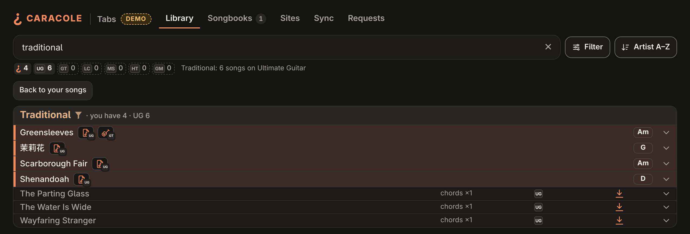
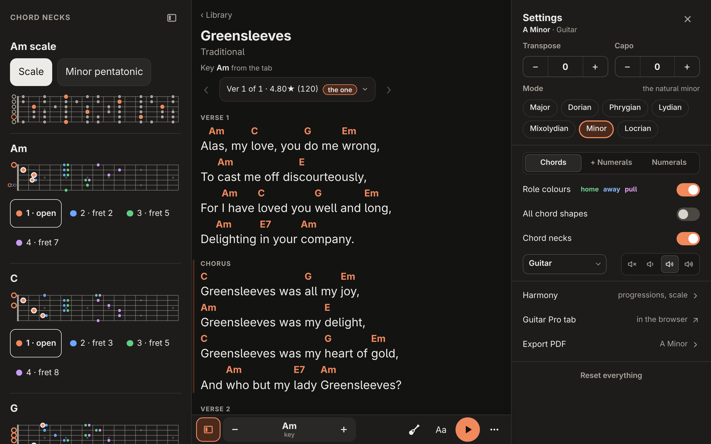
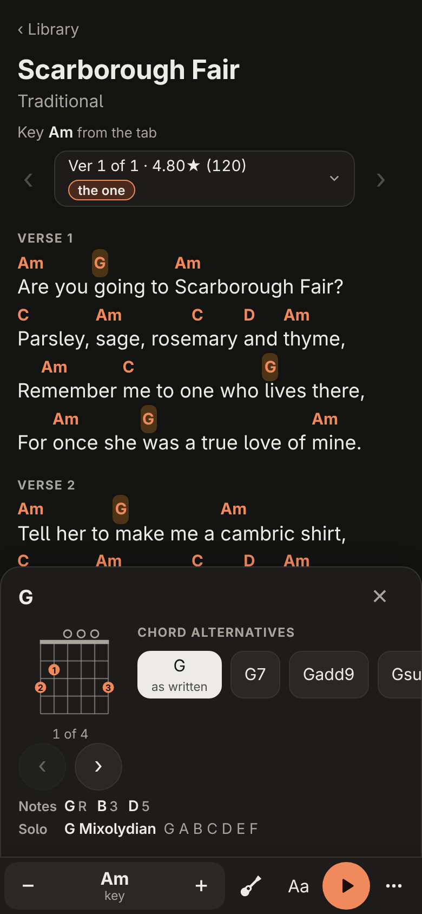
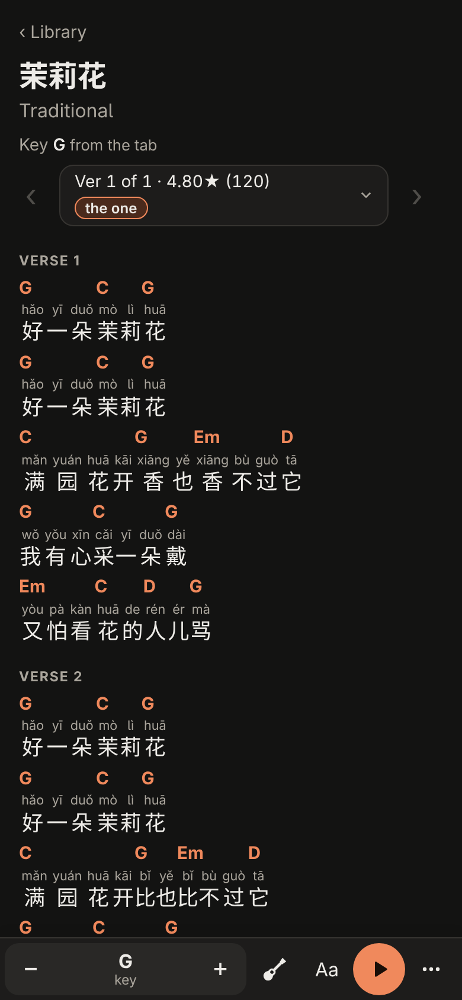
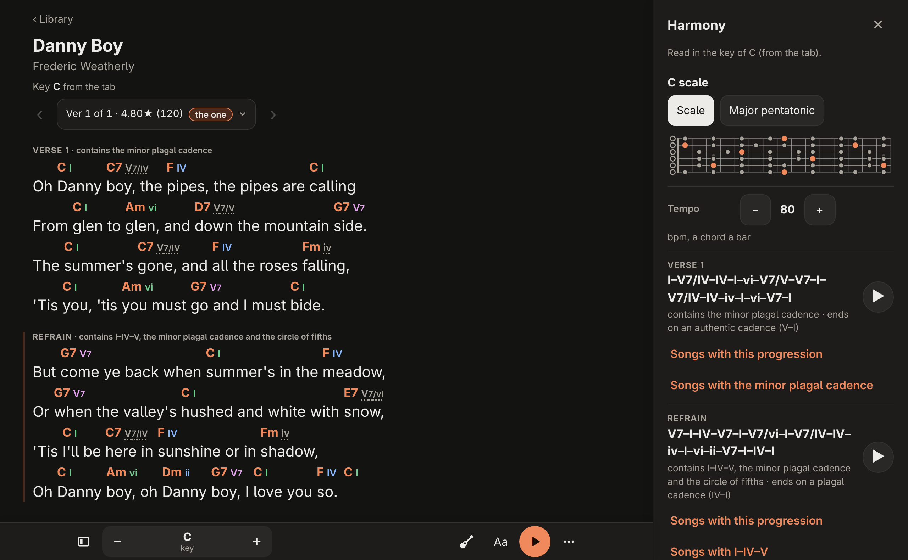
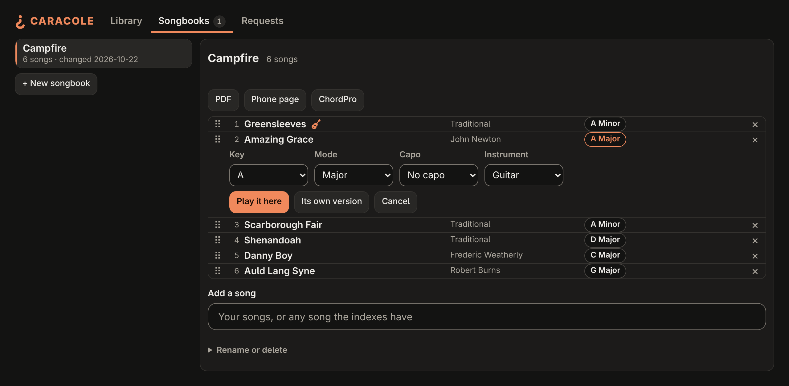
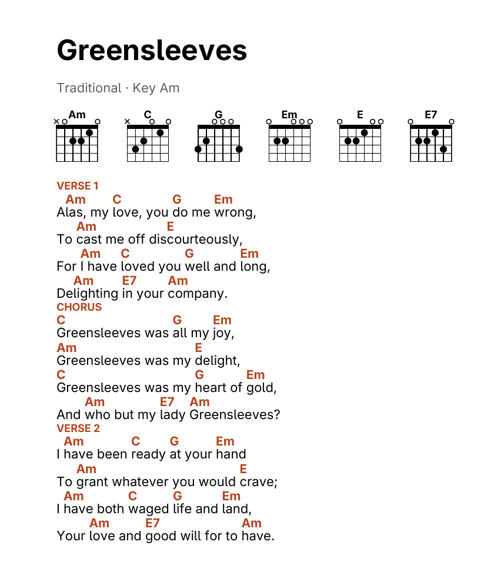
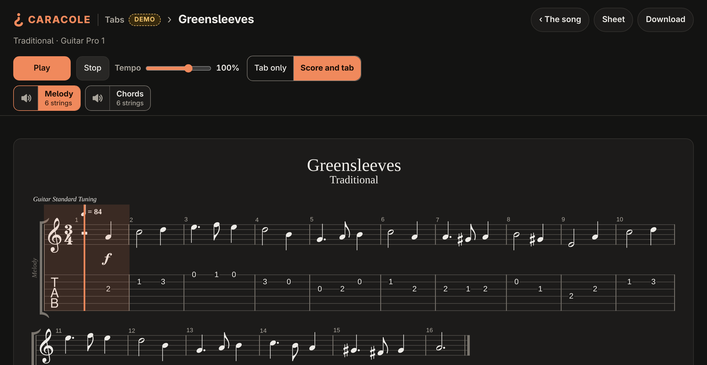

# caracole

**Your own songbook, built while you sleep.**

List the songs you want to play. Every night caracole finds their chords and lyrics and files
them in a private library on your computer, as sheets to read in the browser, on your phone
or on paper.





## What you get

- **Sheets for your songs:** chords and ukulele chords from Ultimate Guitar and LaCuerda;
  lyrics from LRCLIB, then Megalobiz for timed ones and AZLyrics for plain ones; Guitar Pro
  files from gtptabs.com; harmonica tabs from harptabs.com; video game music tabs from
  gametabs.net; links to MuseScore's scores.
- **Chords for the uncharted:** an optional add-on works them out from the audio of a song you
  bought, of a few songs a night from YouTube, or of a video you paste on the library page.
- **Made for playing:** transpose, capo and mode; chord shapes for guitar, ukulele (high G,
  low G, baritone), piano, harmonica, flute and recorder, each strummed or played on a tap;
  a harmony panel with each chord's Roman numeral and the progressions each section plays;
  pinyin over Chinese lyrics, in Simplified or Traditional characters; harmonica tabs read
  onto the harp of your choice; Guitar Pro files drawn as score and tab and played in the
  browser; PDFs, and songbooks with each song in your key and on your instrument.
- **One search, no request:** your songs and every site's index together, found as you type,
  by name, by artist or by chord progression, with "did you mean" for a misspelling. A song
  you haven't got is one tap from your library.
- **Your choice of version:** the Ultimate Guitar versions of a sheet kept side by side, a
  switcher to change, and Make this my version to keep your key, capo and chord swaps.
- **The library page:** one line a song, a button for each thing to play from it; Requests,
  what was asked and how it went; Sites, what each site holds and allows.
- **Two caracoles in step:** sync a computer's library with another's or with the phone's,
  both ways, choosing where both changed a song, or copy it whole into a `.caracole` file.
- **Yours alone:** no account, no cloud, one folder you own.

<details>
<summary>More pictures</summary>

<p>
  
  
</p>









A demo library of public-domain songs, which [docs/screenshots/make.py](docs/screenshots/make.py)
builds and photographs.

</details>

## On Android

The app keeps your library on the phone and runs caracole there, so it works with the
computer off.

- **Your library, offline:** the library page, every sheet with all its tools, kept versions,
  harmonica tabs and songbooks, with no network.
- **Search and fetch from the phone:** the computer's site indexes come with a sync, so the
  phone's search finds songs on the sites offline; Get it looks a song up from the phone,
  at the same gentle pace, and the phone builds its pages itself.
- **Sync with your computer:** the bar's sync button compares the two libraries and each takes
  what the other changed: songs, songbooks and site indexes. Where both changed a song, you
  pick which to keep. It can sync by itself on Wi-Fi every 6 hours, or carry a library over
  in a `.caracole` file when the two can't reach each other.
- **Songbooks and versions:** make and change songbooks, choose a sheet's version, choose how
  a harmonica tab is read, and print a sheet in any key from Android's print dialog.
- **Guitar Pro on the phone:** a file drawn as score and tab and played, each track shown or
  muted.
- **Share to caracole:** share a song from a music app (Spotify, Apple Music, TIDAL, YouTube,
  Deezer, Shazam and more) to find it or fetch it; share a Guitar Pro file or a score to file
  it under its song.
- **Alerts and backups:** a notification when a site turns a lookup away or a request fails in
  the background, and backups of the phone's library to restore from.

It is a debug APK you build and install yourself, with no Play Store:
[build, install and use it](android/README.md).

## Try it

```sh
nix shell github:Danielhp95/caracole     # Linux x86_64; other ways in docs/install.md
caracole add "Oasis - Wonderwall"        # "Artist - Title", a line of ~/Tabs/wanted.txt
caracole index build                     # once, about 4 minutes
caracole run                             # what the nightly run does, now
caracole serve                           # your library at http://127.0.0.1:8737/
```

Your library is the folder `~/Tabs`; nothing needs configuring to start. `caracole serve` has
no sign-in, so share it only on a network you trust.

## Be a good guest

caracole reads other people's websites gently: one request at a time, a pause between two, a small
budget a night, never a page a site's robots.txt closes ([how](docs/usage.md#caracole-run)).
The exceptions are your choice, each one a switch (`[providers.NAME] enabled = false`):

- **YouTube:** the optional auto-chords add-on takes the audio of a few uncharted songs a night
  from it, against its robots.txt and terms ([why](docs/usage.md#audio-from-youtube)).
- **harptabs.com, gametabs.net and AZLyrics:** their terms forbid bots, yet caracole keeps a tab
  or a song's lyrics from them, for your songs alone, robots.txt honoured.
- **A link shared to the phone:** Spotify's, TIDAL's and YouTube's terms forbid automated
  access, yet the phone asks the service once to name the song, one request a share.

The sheets and lyrics are other people's work, so keep your library private.

## More

[Install](docs/install.md) · [Usage](docs/usage.md) · [Run it on a server](docs/deploy.md) ·
[Android app](android/README.md)

To hack on it: `nix develop`, then `pytest -q`. [AGENTS.md](AGENTS.md) says how the code is
laid out and the rules a change keeps.

MIT licensed.
