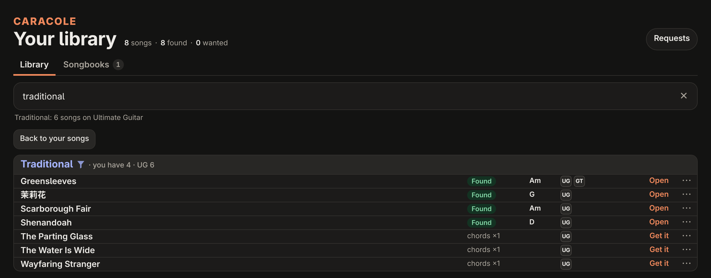
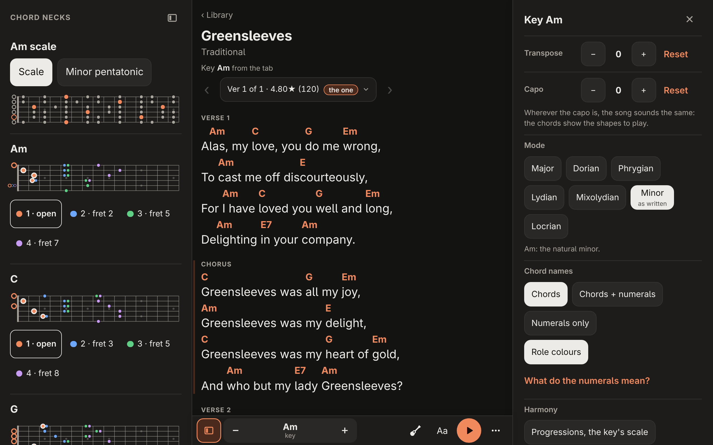
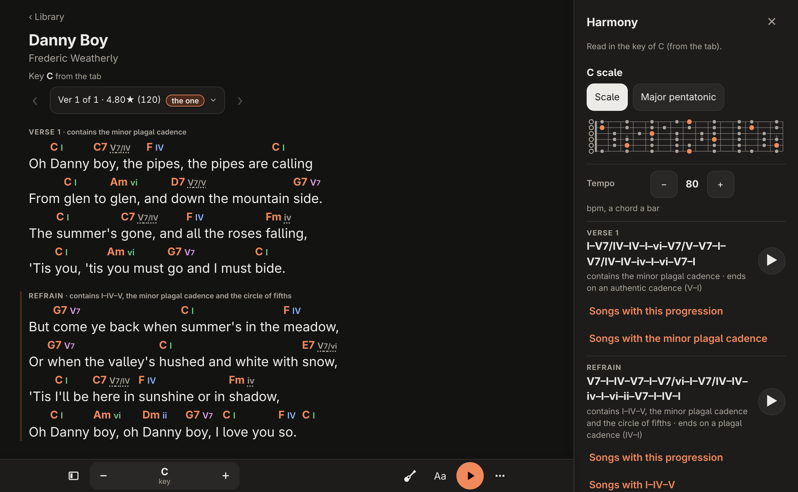
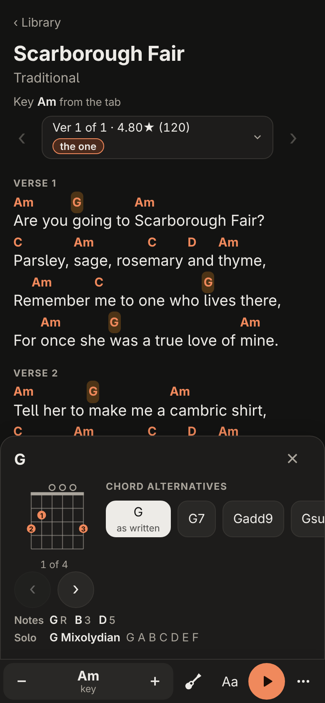
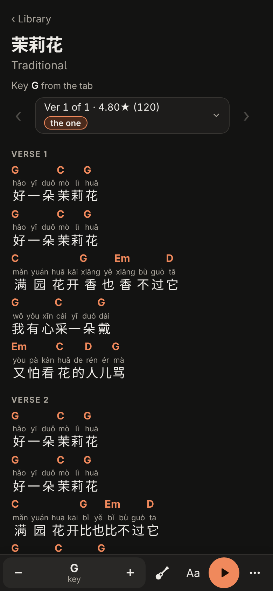
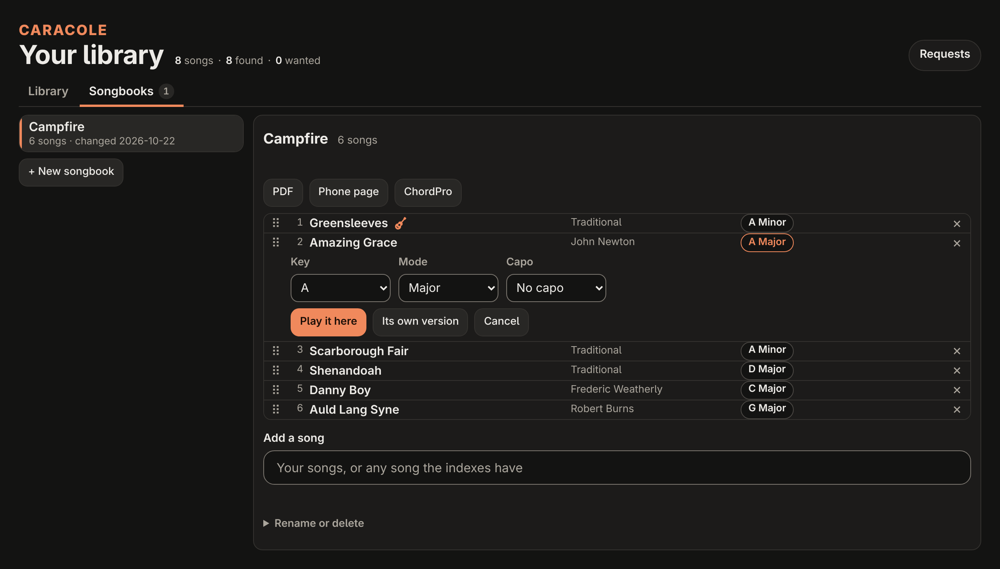
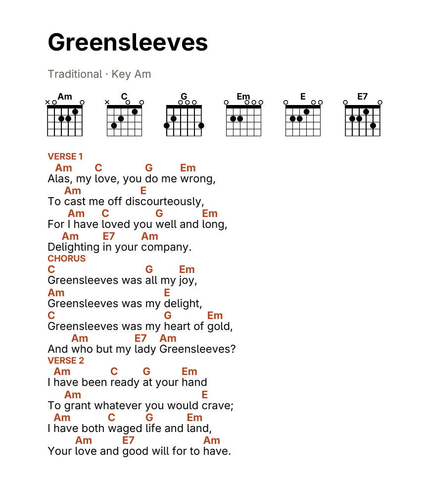
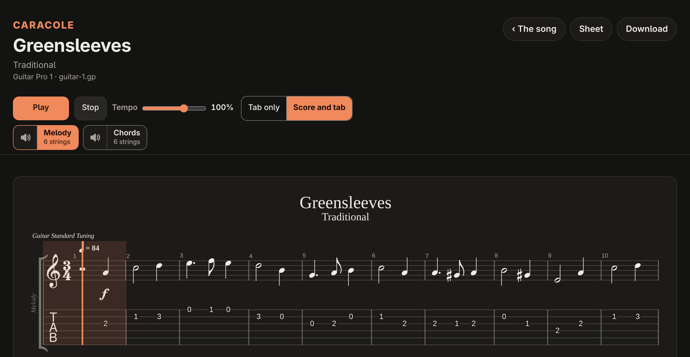

# caracole

caracole builds a private library of sing-along chord sheets, chords over the full
lyrics, for the songs you list. Every night it finds each new song's sheet (Ultimate
Guitar, LaCuerda), its lyrics (LRCLIB) and a Guitar Pro file where gtptabs.com has
one, and makes a PDF and a phone-friendly page of the sheet; for a song nobody has
charted, the optional auto-chords package works the chords out from the audio.
`caracole serve` puts the library, its search and your songbooks on your network.



*Search your songs and the sites' indexes as you type; a song you haven't got is a Get it away.*



*Each sheet: the chords over the lyrics, their shapes on the neck, transpose, capo and mode.*



*The Harmony panel reads each section in its key: numerals, named progressions, and a ▶ that strums them.*

<p>
  
  
</p>

*On a phone: tap a chord for its shapes, its notes and a scale to solo in; pinyin over Chinese lyrics.*



*Songbooks: a set list with each song in the key you play it in, as a PDF, a phone page and a ChordPro file. The guitar marks a song with a Guitar Pro file.*



*Every sheet and songbook is a PDF too, with its chord diagrams.*



*A song's Guitar Pro file, drawn and played in the browser.*

The pictures show a demo library of public-domain songs, which
[docs/screenshots/make.py](docs/screenshots/make.py) builds and photographs.

## Quick start

```sh
nix shell github:Danielhp95/caracole            # x86_64-linux; or see docs/install.md
caracole add "Oasis - Wonderwall"               # "Artist - Title": a line of ~/Tabs/wanted.txt
caracole index build                            # once: Ultimate Guitar's sitemaps, about 10 minutes
caracole run                                    # what the nightly run does, now
caracole serve                                  # the library at http://127.0.0.1:8737/
```

The library is the folder `~/Tabs`. No settings are needed to start; they go in
`~/.config/caracole/caracole.toml`. `caracole serve --address` serves your network:
the page has no sign-in, so keep it on a network you trust (your LAN or tailnet).

- [docs/install.md](docs/install.md): installing it.
- [docs/usage.md](docs/usage.md): every command, setting and file.
- [docs/deploy.md](docs/deploy.md): running it on a server.

caracole is gentle with the sites it reads: one request at a time, seconds apart,
within a small budget, never a page robots.txt closes, and at least a day's rest
when a site pushes back ([how](docs/usage.md#caracole-run)). The one site whose
robots.txt it goes against is YouTube, against its terms too: only the auto-chords
package takes audio there, for a few songs nobody has charted, within its own
budget and pauses, resting after a block like any site, and
`[providers.youtube] enabled = false` turns it off
([why](docs/usage.md#audio-from-youtube)). Keep your library private: the sheets
and lyrics are other people's work.

## Development

`nix develop`, then `pytest -q`. [AGENTS.md](AGENTS.md) says how the code is laid
out and the rules a change keeps.

## License

MIT.
