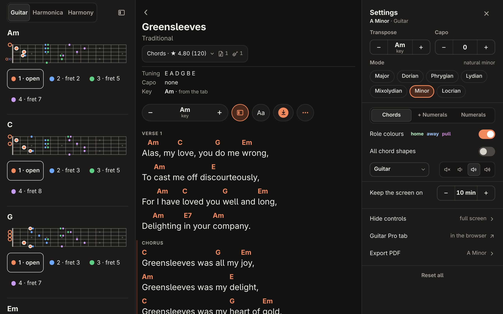
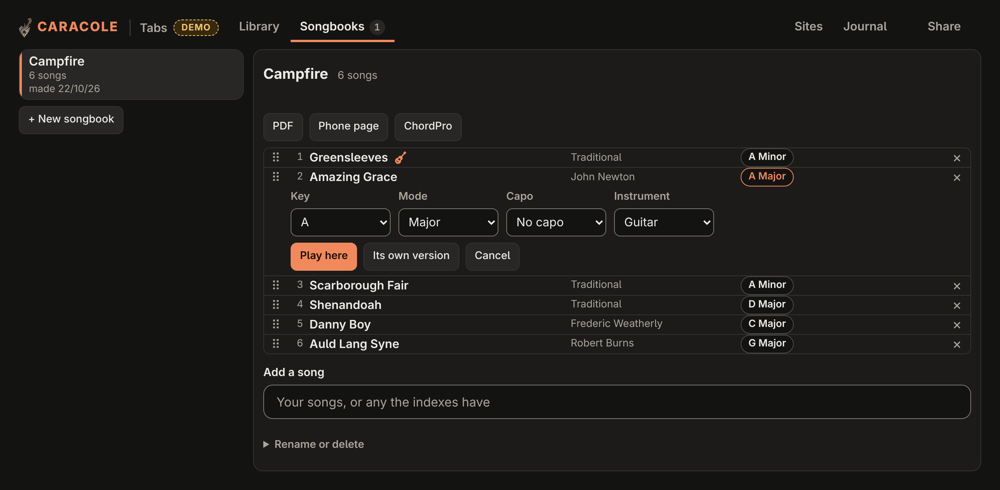
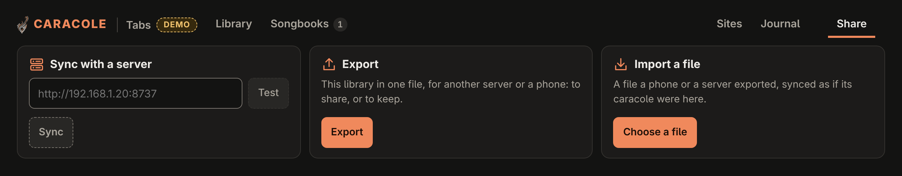

# caracole

caracole collects chords, lyrics and tabs for the songs you want to play.

You keep a list of songs in a text file. Every night caracole looks them up on a few tab and
lyrics sites and saves what it finds in a folder on your computer. You read the songs in a
browser, in the Android app, or on paper. There is no account and no cloud.


## What it does

- Finds chord sheets, lyrics, Guitar Pro files, harmonica tabs and jazz charts on [several sites](docs/sources.md).
- [Shows each sheet](docs/sheets.md) with transpose, capo, chord shapes for several instruments, and sound.
- [Searches](docs/search.md) your songs and the sites' catalogues as you type, offline.
- [Makes PDFs and songbooks](docs/songbooks.md).
- Optional: [works out chords from the audio](docs/autochords.md) when no site has them, on the computer or,
  from a file or a YouTube video, [on the phone](docs/autochords.md#on-the-phone).
- [Syncs with an Android app](docs/phone.md).

## Computer and phone

The computer does the nightly work. The phone keeps a copy and syncs with it.

| | Computer | Phone |
|---|:-:|:-:|
| Nightly run over your song list | Yes | No |
| Build the sites' catalogues | Yes | No, gets them by sync |
| Search, offline | Yes | Yes |
| Fetch one song now | Yes | Yes |
| Read sheets, songbooks, Guitar Pro | Yes | Yes |
| PDFs | Yes | Print only |
| Chords from audio | Yes | From a file or a YouTube video (an arm64 phone) |
| Words heard from the audio | Yes | No |
| Share a song or file from another app | No | Yes |

## Install

**Computer**, with Nix on Linux:

```sh
nix profile add github:Danielhp95/caracole
caracole add "Oasis - Wonderwall"        # adds a line to ~/Tabs/wanted.txt
caracole index build                     # once, about 4 minutes
caracole run                             # tonight's run, now
caracole serve                           # http://127.0.0.1:8737/
```

`caracole serve` has no sign-in. Use it only on a network you trust.

**Phone**: in F-Droid, go to Settings › Repositories › **+** and add
`https://danielhp95.github.io/caracole/fdroid/repo?fingerprint=B34AD39AD80D6CE828F0885C68FD81816230BB3CB482C9E7BCC6DAD844500397`.
Install caracole from there, then [connect it to your computer](docs/phone.md#install-and-connect).

For a nightly service, Ubuntu without Nix, a source checkout, or your own build of the app, see
[docs/install.md](docs/install.md).

## Gallery

The pictures show a demo library of public-domain songs.

<table>
<tr><td valign="top" width="400"><br><b>Search:</b> your songs and what the sites have, in one list.</td><td valign="top" width="400"><br><b>A song's card:</b> its files and where each came from.</td></tr>
<tr><td valign="top" width="400"><br><b>A sheet:</b> chords over the lyrics, chord shapes, key and capo.</td><td valign="top" width="400"><br><b>Harmony:</b> each section's progression in Roman numerals.</td></tr>
<tr><td valign="top" width="400"><br><b>A harmonica tab:</b> the holes over the words.</td><td valign="top" width="400"><br><b>Guitar Pro:</b> score and tab, with playback.</td></tr>
<tr><td valign="top" width="400"><br><b>Songbooks:</b> a set list, each song in your key.</td><td valign="top" width="400"><br><b>A songbook's PDF.</b></td></tr>
<tr><td valign="top" width="400"><br><b>Sites:</b> what each site has, and what you kept from it.</td><td valign="top" width="400"><br><b>Share:</b> sync with another caracole, or export to a file.</td></tr>
</table>

<table>
<tr><td valign="top" width="260"><br><b>Phone:</b> the library.</td><td valign="top" width="260"><br><b>Phone:</b> a chord's shape, notes and scale.</td><td valign="top" width="260"><br><b>Phone:</b> pinyin over Chinese lyrics.</td></tr>
</table>

## More

- [Manual](docs/usage.md) · [Install](docs/install.md) · [Run it as a nightly service](docs/deploy.md)
- [The sites caracole reads, and its rules there](docs/sources.md)
- [Building the Android app](android/README.md) · [Working on the code](AGENTS.md)

MIT licensed. The sheets and lyrics are other people's work, so keep your library private.
