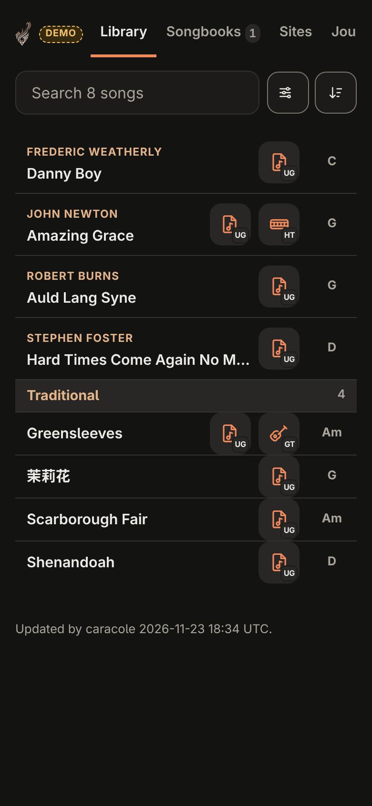

# The Android app

The app keeps a copy of your library on the phone, so you can read and play with the computer
off. It syncs with the computer when you ask, or by itself on Wi-Fi.

  
  

## Install and connect

1. In F-Droid, go to Settings › Repositories › **+** and add
   `https://danielhp95.github.io/caracole/fdroid/repo?fingerprint=B34AD39AD80D6CE828F0885C68FD81816230BB3CB482C9E7BCC6DAD844500397`.
   Install caracole from there. (Or [build it yourself](../android/README.md#build).)
2. On the computer, run `caracole serve --address 0.0.0.0`. It has no sign-in, so do this only
   on a network you trust.
3. In the app's Settings, type the computer's address, for example `http://192.168.1.20:8737`,
   and tap **Test**.
4. Tap **Sync**, right beside Test, or the sync button in the top bar.

## Without a computer

If you have no computer to sync with, search still works. Settings › **Download the site
catalogues** fetches every site's index, about 80 MB to download and several times that on the
phone once it is unpacked. The first time you open the app with no computer set, it offers the
same download. On mobile data it asks first.

The catalogues are made on the author's computer and published once a week, so a download is
usually a week old at most. Settings shows the date of the ones you have. Tap again to
get newer ones; it says "Up to date" when there are none. Nothing is asked of GitHub until you
tap. If the newest file is for a different version of the app, it says so: update the app, or
wait for new catalogues. Your own songs, sheets and lookups don't depend on them.

## Sync

The sync button compares the two libraries, and each side takes what the other changed. You
choose what to include: your songs, your songbooks, and the site indexes that search needs.
If a song changed on both sides, you pick which one to keep. The phone backs up its library
before it takes anything.

A sync downloads a site's index only when the computer has read that site since the phone's
copy, whether that copy came from an earlier sync, a file or the downloaded catalogues; the pages
your lookups sent it don't count. It then downloads only what the phone doesn't hold: the
sitemaps read again and the pages read since, a few MB after a night rather than the whole
index. The **Site indexes** line lists those, and the pages your
lookups read that go to the computer. When the computer runs a caracole of another database
version than the app, no index goes either way, and the line says which to update. Once done,
the sync says how many tabs each index brought that the phone didn't have ("+231 new tabs"),
or "up to date".

**Sync on Wi-Fi**, in Settings, does this every 6 hours. It leaves conflicts for you and sends a
notification. Its line says "Up to date" only when nothing was left; otherwise it counts what
wasn't synced. Conflicts end it with "tap Sync to choose": the sheet shows each one. Anything
else left ends it with "the Journal says why" ("1 taken · 1 not synced: the Journal says
why"): open that sync's Output in the Journal to see each one and why, by its name ("Left as it
was: Radiohead - Creep: changed here since compared"). The same Output names what a sync or a
file's import took and gave ("Took Oasis - Wonderwall (removed)", "Gave Muse - Hysteria", "Took
Blur - Song 2: changed on both sides"), the first 20 each way, then how many more.

Both sides must run versions of caracole that name songs by the same rules. When they don't, the
sync refuses before taking anything: "This caracole and the other name songs by different rules:
update both to the same version, then sync."

If the phone can't reach the computer, **Export** in Settings writes the library to a
`.caracole` file and **Import a file** reads one. Two computers sync the same way, with
[`caracole peer`](usage.md#two-caracoles-the-phones-and-the-computers). An import that left
something reads the same on both: "Shared · 1 change left as it was", its Output naming each and why.

## What works on the phone

- Reading, offline: sheets with all their tools, kept versions, harmonica tabs, Guitar Pro files
  and songbooks.
- Search across your songs and the sites, offline, once a sync or the catalogues download has brought
  the site indexes.
- **Fetch**: the phone looks a song up itself, over Wi-Fi or mobile data.
- Making and editing songbooks, and choosing a sheet's version.
- **Export PDF** opens Android's print dialog, to print or save as PDF.
- Sharing to caracole from another app: a song from Spotify, Apple Music, TIDAL, YouTube, Deezer
  or Shazam to look it up, or a Guitar Pro file or score to file under its song.
- Backups, daily and before each sync (Settings › Backups).
- Pinch to change the text size.

## A sheet from a YouTube video (debug build)

A song no site has chords for can get a sheet made from a YouTube video, on the phone itself.
For now this is in the [debug
build](../android/README.md#a-sheet-from-a-youtube-video-debug-build) alone, and it needs the
chord models on the phone.

Paste the video into the request form's YouTube field, or into a song's card and tap **Make
sheet**, or share it from the YouTube app and tap **Make its sheet from this video**. The phone
downloads the audio with yt-dlp, asks the lyrics sites for the words, works out the chords,
keeps the sheet and deletes the audio. Nothing is downloaded before you tap. It works on Wi-Fi
or mobile data.

Settings › **YouTube audio** says whether it can run, and how many times it ran yt-dlp in the
last 24 hours. The phone keeps the computer's limits, counted on its own, and the same caveat:
taking audio from YouTube goes against its terms ([the sites caracole reads](sources.md)).
`[providers.youtube] enabled = false` on the computer turns it off on the phone at the next
sync.

## What stays on the computer

The nightly run, building the site indexes, PDF files and iReal Pro charts, and, but for the
debug build's sheet from a YouTube video, chords from audio. A song you add on the phone without
fetching it is picked up by the computer's next nightly run, after a sync.

| | Computer | Phone |
|---|---|---|
| Nightly run over your song list | Yes | No |
| Build the site indexes | Yes | No, gets them by sync or one tap |
| Search, offline | Yes | Yes, once synced or downloaded |
| Fetch one song now | Yes | Yes |
| Sheets, songbooks, versions, Guitar Pro | Yes | Yes |
| PDF files | Yes | No, prints instead |
| Chords from audio, YouTube | Optional | Debug build only, from a video |
| iReal Pro charts | Yes | No |
| Watch your `Music/` and `_inbox/` folders | Yes | No, share files to the app |
| Share from another app | No | Yes |
| Web page for other devices | Yes, `caracole serve` | No |
| Backups | Yes | Yes |
| Alerts | ntfy | Android notifications |
| Request limits per site | Its own | Its own |

More: [syncing from the phone](../android/README.md#sync-from-the-phone),
[sharing a song](../android/README.md#sharing-a-song-from-a-music-app).
