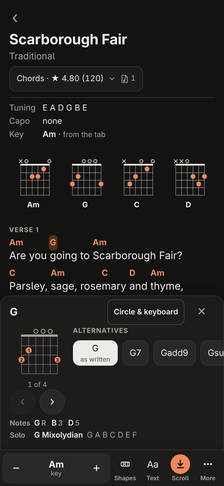

# The Android app

The app keeps a copy of your library on the phone, so you can read and play with the computer
off. It syncs with the computer when you ask, or by itself on Wi-Fi.

  
  

## Install and connect

1. In F-Droid, go to Settings › Repositories › **+** and add
   `https://danielhp95.github.io/caracole/fdroid/repo?fingerprint=B34AD39AD80D6CE828F0885C68FD81816230BB3CB482C9E7BCC6DAD844500397`.
   Install caracole from there. (Or [build it yourself](../android/README.md#build).)
2. On the computer, run `caracole serve --address 0.0.0.0`. It has no sign-in, so do this only
   on a network you trust.
3. In the app's Settings, type the computer's address, for example `http://192.168.1.20:8737`,
   and tap **Test**.
4. Tap the sync button in the top bar.

## Sync

The sync button compares the two libraries, and each side takes what the other changed. You
choose what to include: your songs, your songbooks, and the site catalogues that search needs.
If a song changed on both sides, you pick which one to keep. The phone backs up its library
before it takes anything.

**Sync on Wi-Fi**, in Settings, does this every 6 hours. It leaves conflicts for you and sends a
notification.

If the phone can't reach the computer, **Export** in Settings writes the library to a
`.caracole` file and **Import a file** reads one. Two computers sync the same way, with
[`caracole peer`](usage.md#two-caracoles-the-phones-and-the-computers).

## What works on the phone

- Reading, offline: sheets with all their tools, kept versions, harmonica tabs, Guitar Pro files
  and songbooks.
- Search across your songs and the sites, offline, once a sync has brought the catalogues.
- **Fetch**: the phone looks a song up itself, over Wi-Fi or mobile data.
- Making and editing songbooks, and choosing a sheet's version.
- **Export PDF** opens Android's print dialog, to print or save as PDF.
- Sharing to caracole from another app: a song from Spotify, Apple Music, TIDAL, YouTube, Deezer
  or Shazam to look it up, or a Guitar Pro file or score to file under its song.
- Backups, daily and before each sync (Settings › Backups).
- Pinch to change the text size.

## What stays on the computer

The nightly run, building the site catalogues, chords from audio, YouTube, PDF files and iReal
Pro charts. A song you add on the phone without fetching it is picked up by the computer's next
nightly run, after a sync.

| | Computer | Phone |
|---|---|---|
| Nightly run over your song list | Yes | No |
| Build the site catalogues | Yes | No, gets them by sync |
| Search, offline | Yes | Yes, once synced |
| Fetch one song now | Yes | Yes |
| Sheets, songbooks, versions, Guitar Pro | Yes | Yes |
| PDF files | Yes | No, prints instead |
| Chords from audio, YouTube | Optional | No |
| iReal Pro charts | Yes | No |
| Watch your `Music/` and `_inbox/` folders | Yes | No, share files to the app |
| Share from another app | No | Yes |
| Web page for other devices | Yes, `caracole serve` | No |
| Backups | Yes | Yes |
| Alerts | ntfy | Android notifications |
| Request limits per site | Its own | Its own |

More: [syncing from the phone](../android/README.md#sync-from-the-phone),
[sharing a song](../android/README.md#sharing-a-song-from-a-music-app).
