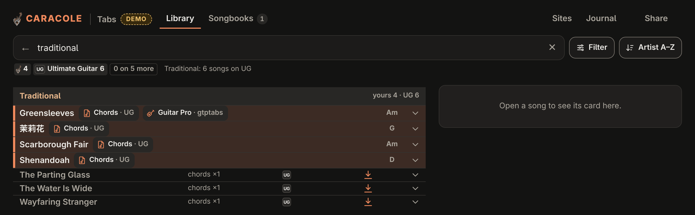
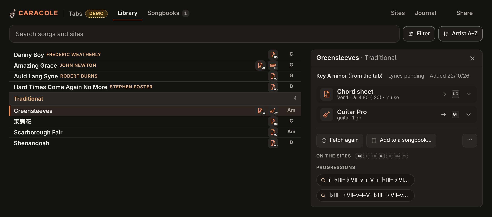

# Search

The search box on the library page finds your songs and the songs the sites have, as you type.
It reads the copy of each site's catalogue that caracole keeps on your computer, so a search
contacts no site, with the two exceptions below.

## What you can type

- Words from the title, the artist, or both. Case and accents don't matter.
- One word of an artist's name ("skynyrd"), or a title's initials ("wywh" for Wish You Were Here).
- Chinese titles by their pinyin ("banma").
- A key ("a minor", "F# major") or a chord progression ("vi IV I V", "andalusian"). These look
  through your own songs only.
- A misspelling gets a "Did you mean…?".

Opened as a file, the page searches only your songs. The sites' catalogues need `caracole serve`
or the Android app.

**Filter** narrows the list by status, by what a song has (chords, Guitar Pro, ukulele,
harmonica, score) and by key. **Sort** orders it by artist, by title or by date added. The
address bar keeps your search and filters, so you can bookmark them.

## Results

Your songs come first, grouped by artist. A song that several sites have is one line. Tap its
name to see what each site has, or press the download button to fetch it now. Nothing is sent to
a site until you press that button. **Add for tonight** leaves the song to the nightly run.

A song you already have opens its card: its files, where each came from, and its progressions.

If nothing matches, the query turns into a line with **Request**, which asks for the song by name.

The page's other tabs: **Songbooks**, **Sites** (what each site has and how it is doing),
**Journal** (what you asked for and how it went) and **Share** (sync).

## Paste a link

Paste a YouTube link to make a sheet from that video, or an Ultimate Guitar link to keep that
exact version. caracole reads that one page once and shows what it found before you confirm.

## When a search does contact a site

- **LaCuerda's own search** covers artists that caracole's copy doesn't list yet. The page sends
  it by itself when your songs and the copy have no good answer: at most 20 an hour, and each
  query once in 30 days.
- **YouTube's first video** for a search no site has a sheet for, if you have
  [chords from audio](autochords.md) installed: at most 10 an hour.

The marks under the box show how many songs each site found, and whether a site is still being
read or has blocked caracole.

## From a terminal

`caracole search QUERY` does the same and sends no request. `--add N` adds hit N to your list.
See [caracole search](usage.md#caracole-search) for the other options, and
[Library/index.html](usage.md#libraryindexhtml) for everything on the page.
