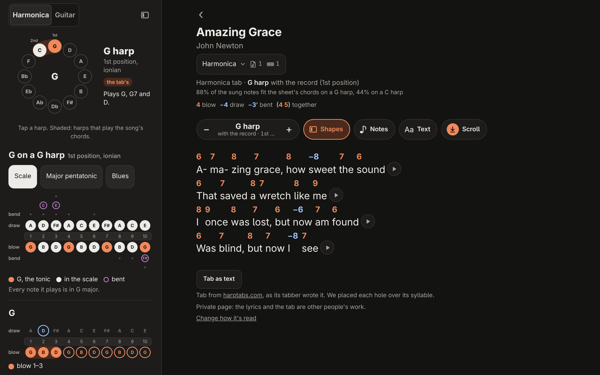

# Reading a song

Every song opens as a page in your browser, with its chords over the lyrics. The page sits in
the song's folder and works offline.

## The sheet

- Change the key with − and + in the bar, or tap the key to pick one. Capo and mode are under ⋯.
- If the key is awkward, **Easier shapes** suggests a capo.
- Pick your instrument under ⋯: guitar, ukulele (high G, low G, baritone), piano, harmonica, flute or recorder.
- Tap a chord to hear it and see its shapes, its notes, a scale to solo over, and chords to play instead.
- **Scroll** scrolls the song after a 3-second count. Touch the screen to pause. If the song has
  timed lyrics, the line being sung is lit.
- **Chord names** adds Roman numerals. The Harmony tab lists each section's progression and plays it.
- Chinese songs can show pinyin, in Simplified or Traditional characters.
- **Aa** sets the text size and the theme. **Hide controls** gives the song the whole screen.
- **Reset all** undoes your changes.

The page takes no keyboard shortcuts, so a page-turner pedal scrolls it like any other page.
More in the manual: [the sheet viewer](usage.md#the-sheet-viewer).

## Versions

- Ultimate Guitar often has several versions of a song. caracole picks one as the sheet and keeps two more.
- The line under the artist says which one you are reading ("Chords · Ver 7 of 13 · ★ 4.80").
  Tap it to see them all and open a kept one.
- With `caracole serve` you can keep another version, or make one the sheet, from that list.
  Without it, use [`caracole versions`](usage.md#caracole-versions).
- **Export PDF**, under ⋯, downloads the song as you are playing it. **Make mine** also saves
  your key, capo and chord changes as the song's default.

## Harmonica tabs

- A harmonica tab gets its own page, with each hole over its word: blow ("4"), draw ("−4") and bend ("−3′").
- It starts on the harp that plays along with the record. − and + change the harp.
- Tap a hole to hear it. ▶ plays a line. **Notes** shows the note names.
- Tabbers write holes in different ways. If caracole read a tab wrong, pick another reading on
  the page (with `caracole serve`) or run `caracole harmonica`.

More: [the harmonica tab page](usage.md#the-harmonica-tab-page).

## Guitar Pro files

- With `caracole serve` or the Android app, a Guitar Pro file opens in the browser as tab or
  score, and plays.
- You can set the tempo (50 to 125 %) and show or mute each track.
- Opened from the folder, the file downloads instead. Power Tab files always download.
