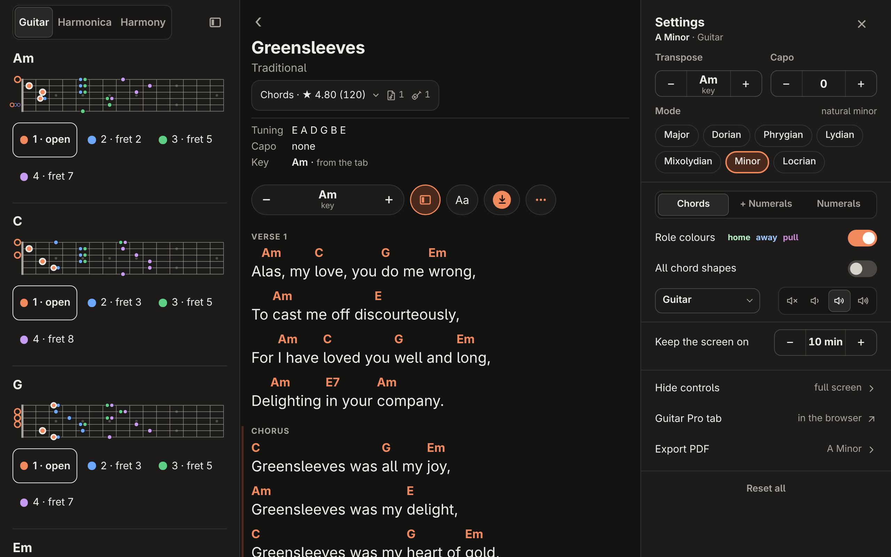
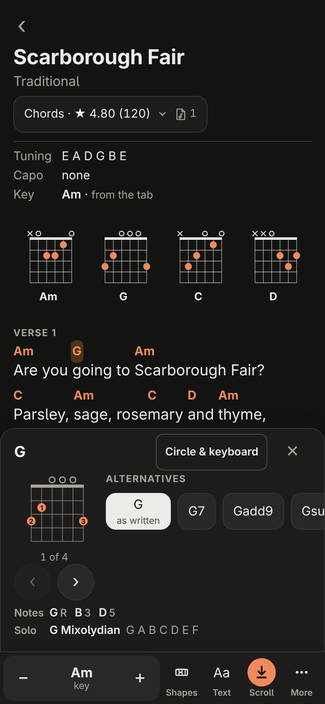
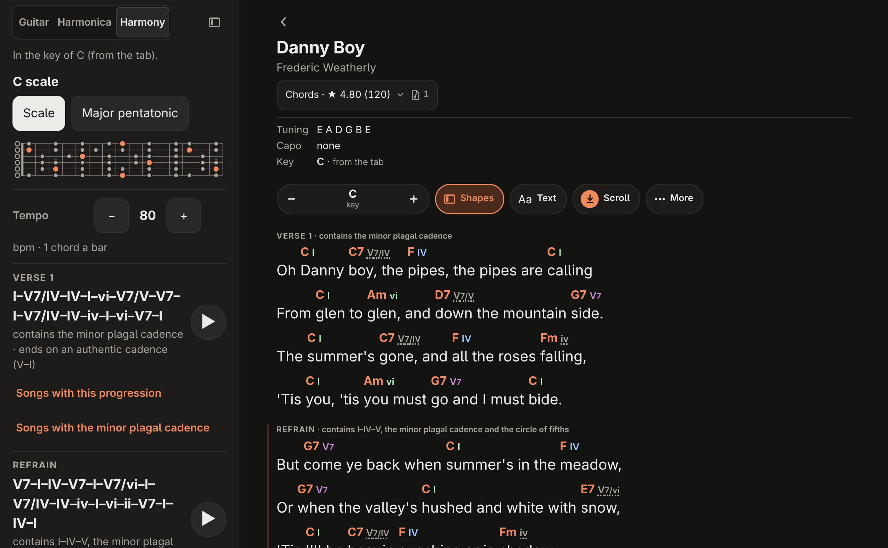

# Reading a song

Each song opens as a page in your browser: its chords over the lyrics, in any key, on your instrument, with sound.
Its other versions, its harmonica tabs and its Guitar Pro files open the same way.

## The sheet

- Each sheet is a page in the song's folder, `sheet.html`. It opens with no server and needs no network.
- Chords sit over their syllables. A long line wraps between words, never between a chord and its word.
- On a laptop, a song that fits the window shows whole, in two to five columns.
- On a Chinese song, **Pinyin**, in ⋯, puts each character's reading over it. Its characters can be Simplified or Traditional.
- Printed, the page is in light colours, in one column, without the bar or the settings.

## Playing along

- **Scroll**, in the bar, counts down 3 seconds, then scrolls the song. A touch or the mouse wheel pauses it.
- If the song has timed lyrics, the line being sung is lit as it scrolls.
- The screen stays on until 10 minutes after your last touch. **Keep the screen on**, in ⋯, sets the minutes.
- **Aa** sets the text size and the theme. **Hide controls**, in ⋯, gives the song the whole screen.
- The page takes none of your keys, so a page turner scrolls it as it scrolls any page.

## Key, capo and mode

- − and + in the bar move every chord a semitone. Tap the key for the twelve keys.
- **Capo**, in ⋯, moves the capo: the song sounds the same, and the shapes change. **Easier shapes** suggests one.
- **Mode** plays the song in another mode on the same note: C major instead of C minor.
- **Reset all**, at the foot of ⋯, puts the key, the capo, the mode and swapped chords back.

## Chords and sound

- Tap a chord for its card: its shapes, its notes, and a scale to solo over it.
- The tap also strums it. The speakers beside **Instrument**, in ⋯, set the volume, or turn it off.
- **Instead, in the key**, on the card, lists chords to play in its place.
- **Instrument**, in ⋯: guitar, ukulele (high G, low G, baritone), piano, harmonica, flute or recorder.
- **All chord shapes**, in ⋯, shows every chord's shape in a strip above the song.

## Harmony

- **Chord names**, in ⋯, adds Roman numerals (I, IV, V, vi), coloured by role. Tap one for its notes.
- A rail on a laptop, or the neck in a phone's bar, has three tabs: **Guitar**, **Harmonica** and **Harmony**.
- **Harmony** lists each section's progression, named when it has a common name. ▶ plays it.
- **Songs with this progression** opens your library on the songs that have it.

More: [The sheet viewer](usage.md#the-sheet-viewer).

## Versions of a sheet

- The line under the artist says which Ultimate Guitar version this is: "Chords · Ver 7 of 13 · ★ 4.80 (1,204)".
- Tap it for the list: every version, the ones kept, and the song's other files to play from.
- caracole keeps three: its pick as the sheet, and two more beside it. A kept one opens from the list.
- On `caracole serve`, **Keep** keeps one more, **Make this the one** makes it the sheet, **Back to our pick** undoes it.
- Opened from the folder, each shows the `caracole versions` command that does it, with Copy.
- Served, **Export PDF**, in ⋯, downloads a PDF of the song as you play it. **Make mine** also makes that your version.

More: [caracole versions](usage.md#caracole-versions).

## Harmonica tabs

- Each harmonica tab gets a page, linked from the sheet's Harmonica row and the library page.
- The holes sit over the words: a blow in rust ("4"), a draw in blue ("−4"), a bend in purple ("−3′").
- caracole reads the tabber's way of writing holes, and says how under the harp ("Read as: …").
- Read wrong? Served, that line offers the other readings. From a terminal, use `caracole harmonica`.
- It starts on the harp that plays with the record, else the one the tab names. − and + change the harp.
- **Notes** names each hole's note. Tap a hole to hear it; ▶ at a line's end plays the line.

More: [The harmonica tab page](usage.md#the-harmonica-tab-page).

## Guitar Pro files

- Served by `caracole serve`, and in the Android app, a song's Guitar Pro file opens in the browser.
- Open it from the song's card, or from **Guitar Pro tab** in the sheet's ⋯.
- It is drawn as tab, or as score and tab, and played: **Play**, **Stop**, and **Tempo**, 50 to 125 %.
- Each track has a button: tap it to show the track. Its speaker mutes it.
- From the folder, the file is a download. A Power Tab file is always a download.

More: [caracole serve](usage.md#caracole-serve), under "Guitar Pro files in the browser".
