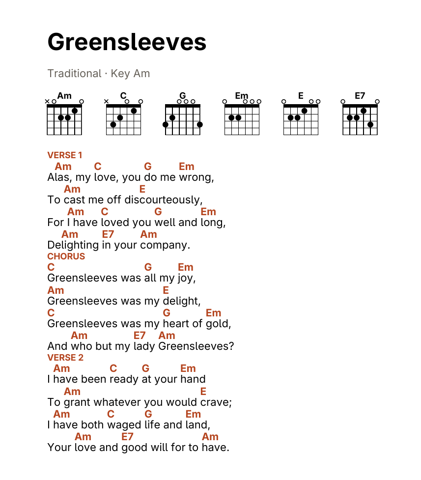
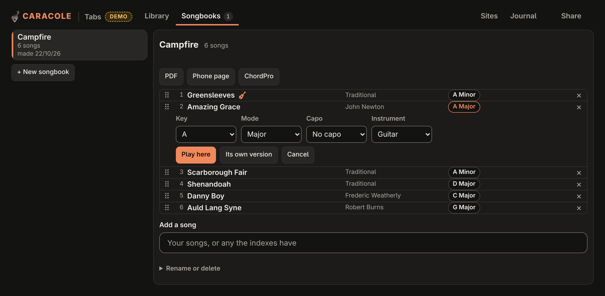

# PDFs and songbooks

caracole makes a PDF of every sheet, and exports one in any key and on any instrument. A songbook puts
some of your songs in order, each where you play it, as a PDF, a page for the phone and a ChordPro file.

## Each sheet's PDF

- Every sheet gets `sheet.pdf` beside it: chord diagrams, then the chords over the words, in two columns.
- Under the title: the artist, the key and the capo. Chords are named as the viewer names them (Bb, not A#).
- It plays the song in your version (below), else as written.
- It is made again when the sheet, your version or the fonts change. Annotate a copy, not `sheet.pdf`.

## Export PDF, in any key and on any instrument

- In the sheet viewer, ⋯ has **Export PDF**, with the version at its right ("D Dorian, capo 2").
- The PDF is what the viewer shows: key, mode, capo, the chords you swapped and the shapes you chose.
- On another instrument it draws that one: ukulele diagrams, piano keyboards, harmonica holes, a flute's scale.
- On `caracole serve` it downloads, writing nothing. Opened as a file, the viewer gives you the command instead.
- A kept version's page has no Export PDF: make it the one first. Nor has the auto sheet beside a human one.

## Make this my version

- On a version other than the song's own, Export PDF asks **Make this your version of …?**
- **Make mine** downloads it and keeps that key, mode, capo, chord swaps, shapes and instrument.
- From then on the song's PDF, viewer and songbooks start there. `sheet.pdf` stays on the guitar.
- Your key is kept as a key: a new sheet in another key still plays in yours.
- **Download only** keeps nothing. From a file, add `--mine` to the command. [Details](usage.md#one-step-at-a-time).

## Chinese sheets and fonts

- A Chinese sheet's `sheet.pdf` is in Simplified characters, with `sheet (Traditional).pdf` beside it. No PDF has pinyin.
- A songbook with a Chinese song gets `songbook (Traditional).pdf` too. Export PDF follows the characters on screen.
- A Chinese PDF needs a CJK font, which the Nix package sets. Until then the sheet has its viewer but no PDF. [Details](usage.md#fonts-for-chinese-sheets).
- With the Nix package the PDFs are set in Adwaita Sans. [Other fonts](usage.md#fonts-in-the-pdfs).

## Songbooks

- A songbook is a name and some of your songs, in order: a set list, the songs for a trip, a book to print.
- Make one with **Select** in the library (or **+ New songbook**): tick songs in order, name it, **Make songbook**.
- Each one is three files in `Library/_songbooks/<name>/`:
  - **`songbook.pdf`**: a title page, the contents, then every song. One with no sheet yet is marked missing.
  - **`songbook.html`**: a page for the phone: the contents, then each song in the sheet viewer.
  - **`songbook.cho`**: every song's ChordPro, for an app such as SongbookPro or OnSong.
- They live in `songbooks.toml` in the library, which you can edit by hand. [Details](usage.md#songbooks).

## The Songbooks tab

- It lists your songbooks. Open one for its set list: each song with the key it is played in.
- A guitar marks a song with a Guitar Pro file. **PDF**, **Phone page** and **ChordPro** open the files.
- On `caracole serve`, drag a song to move it, × to take it out, **Add a song**, or **Fetch** the missing ones.
- There, a song's chip sets its key, mode, capo and instrument. **Its own version** takes that off.
- A song set on another instrument has that instrument's chords in the PDF, and opens on it on the phone page.
- Opened as a file, the tab gives you the commands to run instead. [Details](usage.md#the-songbooks-tab).

## caracole songbook

- `caracole songbook make NAME "ARTIST - TITLE"...` makes one. A loose name or a typo finds the song; it says which.
- `add`, `remove` and `move NAME "ARTIST - TITLE" POSITION` change its songs.
- `set NAME "ARTIST - TITLE" --key K --mode M --capo N --instrument I` sets where it plays; `--clear` undoes it.
- `list` shows every songbook, `show NAME` its songs. `rename NAME NEW` and `delete NAME` do what they say.
- `render [NAME]` makes the files that need it. The nightly run does too. [Details](usage.md#caracole-songbook).

## On the phone

- **Export PDF** prints the sheet as the viewer shows it, through Android's print dialog: a printer or **Save as PDF**.
- It writes nothing into the library, and making it your version works there too.
- You make and change songbooks on the phone, and it makes their phone pages. All of this works offline.
- The phone makes no PDF or ChordPro file of its own; the computer's open in another app.
  [Details](../android/README.md#songbooks-versions-and-printing).
